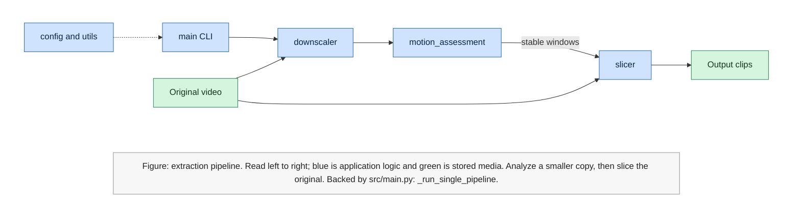
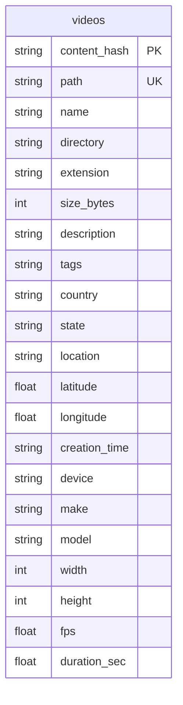

# Thea development

[Back to Thea](../README.md) | [Video algorithm/model research](analysis.md)

## Architecture

Thea is a local Python application, not a distributed service. The CLI composes
module APIs; OpenCV/FFmpeg handle real media. Catalogue indexing, merging,
crop/pan and optional captioning are independent entry points.



Backed by: [pipeline orchestration](../src/main.py),
[downscaler](../src/downscaler/downscaler.py),
[motion analysis](../src/motion_assessment/analyzer.py), and
[slicer](../src/slicer/slicer.py).
This diagram describes code relationships; it is not a GPU execution benchmark.

## SQLite catalogue schema

All production catalogue commands resolve `data_dir\video-index.sqlite3`.
There is one application table, `videos`; captions live in `description`,
not a separate caption file or table. The diagram lists all 21 retained columns.
Types below are logical types: the generic SQLite store adds untyped columns;
`tags` contains a JSON array of strings, returned as an array by the application.
Codec/audio/container details, raw probe JSON and unselected tags are not stored.



Backed by: [Video entity](../src/tools/models/video.py),
[SQLite schema/index creation](../src/tools/storage/sqlite_store.py),
[canonical path](../src/utils/settings.py), and
[catalogue updates/search/import](../src/tools/catalogue.py).

`content_hash` is a fast partial signature, not proof of full byte equality.
`path` is unique; duplicate content retains one representative path.
Reindexing the same content retains stored descriptions and missing metadata;
changed content at the same path does not inherit the previous description.
`creation_time` is the embedded recording timestamp when probed/known, otherwise
the filesystem creation timestamp formatted as UTC ISO 8601. There are no separate
filesystem timestamp columns. File creation time can reset on copies.
Country/state and fallback coordinates can be approximate folder inferences;
there are no persisted provenance columns. `location` retains the raw ISO-6709
string when embedded GPS exists. Tags are user-managed, not imported file tags.
Descriptions are generated text, not a visual-validation guarantee.
See [catalogue behavior](tools/README.md).

## Ownership and layout

| Location | Responsibility | Guide |
|----------|----------------|-------|
| `src\main.py` | CLI parsing and orchestration | [Pipeline](pipeline/dev.readme.md) |
| `src\cli`, `mcp_server.py` | Shared command adapters and optional root-launched MCP server | [Interfaces](mcp/dev.readme.md) |
| `src\motion_assessment` | Optical flow, scores, windows and categories | [Motion](motion_assessment/dev.readme.md) |
| `src\downscaler`, `src\slicer` | Analysis copies and original-source clip extraction | [Downscaler](downscaler/dev.readme.md), [slicer](slicer/dev.readme.md) |
| `src\merger`, `src\cropandpan` | Independent FFmpeg transformations | [Merger](merger/dev.readme.md), [crop/pan](cropandpan/dev.readme.md) |
| `src\tools` | Catalogue model, storage, metadata, geocoding and search | [Catalogue](tools/dev.readme.md) |
| `src\sampled_captioner` | Frame sampling and injectable vision backend | [Captioner](sampled_captioner/dev.readme.md) |
| `src\utils` | Shared configuration, paths, media helpers, logging and metrics | [Utilities](utils/dev.readme.md) |
| `src\<module>\tests` | Deterministic unit tests for that module | [Validation](#validation) |
| `src\integration_tests` | Opt-in real media/GPU/dataset checks and tracked fixtures | [Validation](#validation) |
| `config` | Tracked presets/settings and ignored machine-local overrides | [Configuration](configuration.md) |
| `data` | Ignored generated output and diagnostics | [Configuration](configuration.md) |
| `scripts` | Explicit one-shot metadata/hash diagnostics | [Catalogue development](tools/dev.readme.md) |
| `docs`, `.github`, `.vscode` | Documentation, agent resources, editor configuration | [Agent tooling](agents/README.md) |

This is a single-language repository. Do not introduce a `src\python` layer.
`tools` contains application functionality despite its historical name; only
its one-shot diagnostic scripts belong under `scripts`.

## Setup and configuration

Follow [setup](setup.md), select a compatible environment, and install editable:

```powershell
python -m pip install --no-deps -e .
```

`pyproject.toml` defines `thea`, `thea-index` and optional-server `thea-mcp`, reads common runtime requirements,
and configures default unit-test discovery. Package names remain unchanged.
Module invocation (`python -m main`, `python -m tools.walkdir`) also works after
installation. No source file injects itself into `sys.path`.
The MCP SDK is an optional dependency; see [MCP setup](mcp/README.md).

Configuration paths are centralized in `src\utils\paths.py`. The application is
currently an editable-checkout tool: its `config` directory remains outside the
Python packages. Standalone wheel/executable resource bundling is not implemented.

Use the shared compatible workspace Python environment by default. Keep the
existing ignored CUDA/OpenCV `.venv` isolated rather than replacing it with a
different vendor/backend stack. No acceleration dependencies were changed by
the structural migration.

## Validation

```powershell
python -m pytest -q
python -m ruff check src scripts
python -m main --help
python -m tools.walkdir --help
```

Default pytest collection targets only colocated module tests. Integration
directories and `agenttests` are excluded from recursive discovery before their
imports run. Unit tests fake GPU detection, FFmpeg/probes and network requests;
temporary files and SQLite databases remain local test fixtures.

Only when explicitly requested, run:

```powershell
python -m pytest src\integration_tests -q
```

That command can process real video, invoke FFmpeg, probe a GPU and load
geocoding datasets. Fixtures live in `src\integration_tests\fixtures`; preserve
the tracked sample and reference JSON. Do not assume its historical GPU-specific
expectations also hold for every CPU/backend combination.

Ruff already reports unrelated baseline findings; do not silently disable rules
or mix broad cleanup into a relocation. Format only new/semantically changed
files using the existing Black convention (line length 100), rather than
reformatting every file merely because it moved.

## Workflow

Read `AGENTS.md`, inspect the affected module/tests and worktree, then make the
smallest coherent change. Keep dependent imports, package discovery, editor
launchers and owning docs consistent. Run focused unit checks before broader
default unit discovery. Leave integrations, external servers and inference
opt-in. Record new decisions in [analysis](analysis.md) and verified outstanding
work under [todo](todo/README.md).
