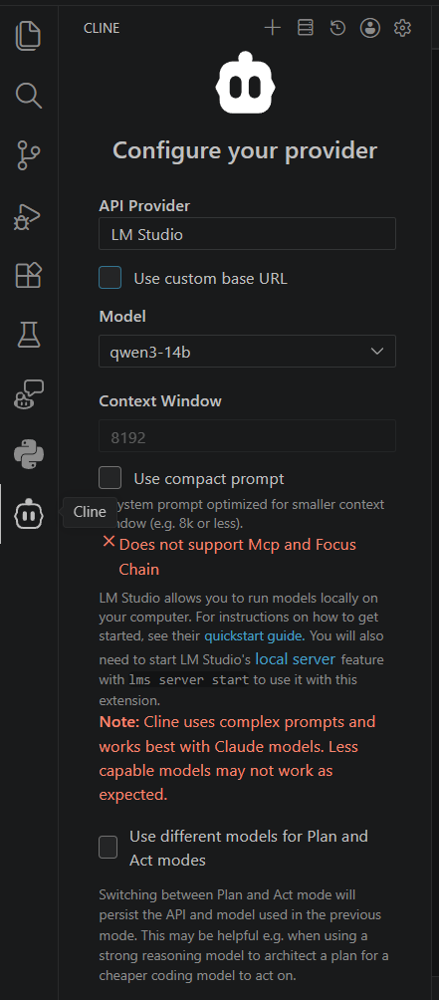

# Optional local AI and external MCP clients

[Back to Thea](../README.md) | [Agent tooling](agents/README.md)

This optional guide configures VS Code with Qwen 3 through LM Studio
(preferred) or Ollama, and describes existing external MCP client connections. It does
not cover Python project compilation or the CUDA toolchain.

Complete [`setup.md`](setup.md) first.

This preserves the existing optional setup guide; model releases, provider UI,
hardware estimates and commands were not revalidated during the layout change.
Nothing here is a required development step or authorization to load a model.

## Install VS Code and Node.js

```powershell
winget install --id Microsoft.VisualStudioCode --exact
winget install --id OpenJS.NodeJS.LTS --exact
```

Open a new terminal:

```powershell
code --version
node --version
npm --version
```

Use Node.js 20 or newer.

## Preferred: Install LM Studio and Qwen 3 14B

Install and open LM Studio:

```powershell
winget install --id ElementLabs.LMStudio --exact
```

In LM Studio:

1. Open **Discover** and search for `Qwen3 14B`.
2. Select the GGUF model and download the `Q4_K_M` variant (about 9 GB).
3. Open **My Models**, find Qwen 3 14B, and select its gear icon.
4. Save these per-model defaults:

| Setting | Recommended value for RTX 4070 SUPER 12 GB |
|---------|---------------------------------------------|
| GPU offload | Maximum |
| Context length | 8192 |
| Flash Attention | On |
| K cache quantization | `Q8_0` |
| V cache quantization | `Q8_0` |
| Parallel requests | 1 |

KV caching is automatically enabled when the model loads. The 8192-token
context leaves enough VRAM for the model weights, runtime, and KV cache. If
`Q8_0` cache quantization is unavailable, keep the default cache type and do
not increase the context length.

Load the model with the identifier `qwen3-14b`, then start the server from
LM Studio's **Developer** tab on port `1234`.

The equivalent CLI commands are available after LM Studio has been opened at
least once:

```powershell
$lms = "$env:LOCALAPPDATA\Programs\LM Studio\resources\app\.webpack\lms.exe"
& $lms get qwen/qwen3-14b@q4_k_m --gguf -y
& $lms load qwen/qwen3-14b --gpu max --context-length 8192 --identifier qwen3-14b
& $lms server start
```

The CLI uses the Flash Attention and KV-cache defaults saved in **My Models**.
Verify that the API and GPU offload are active:

```powershell
Invoke-RestMethod http://localhost:1234/v1/models
nvidia-smi
```

## Alternative: Install Ollama and Qwen 3

```powershell
irm https://ollama.com/install.ps1 | iex
ollama pull qwen3:8b
ollama run qwen3:8b "Reply with: Qwen 3 is ready"
```

Qwen 3 8B is appropriate for a 12 GB GPU. Use a larger Qwen 3 model only when
enough VRAM and system RAM are available.

Verify GPU use:

```powershell
ollama ps
nvidia-smi
```

## Install and configure the VS Code client


For the preferred LM Studio setup, configure Cline as shown:

1. Install Cline with `code --install-extension saoudrizwan.claude-dev`.
2. Select the LM Studio provider, the configured server URL and `qwen3-14b`.
3. Match the context window to the loaded model's configuration; the existing
   example uses 8192 tokens and a compact prompt.

If using a compatible HTTP provider instead, use the configured server's API
base URL and authentication settings. For Ollama, select its provider and actual
server URL rather than reusing the LM Studio endpoint.




## External MCP client configuration

The project-scoped client configuration is checked in at the editor's expected
location below. These are external tools, not Thea-owned application servers:

```text
.vscode/mcp.json
```

| Server | Purpose |
|--------|---------|
| `filesystem` | Read and search files inside the Thea workspace |
| `memory` | Persist project facts and relationships |
| `seq-thinking` | Structured multi-step reasoning |
| `git` | Inspect repository history and changes |

The Node servers run through `npx`; they do not require global npm installs.
Install the optional Git MCP executable only when setting up that integration.
The checked-in client currently points at Thea's existing isolated `.venv`:

```powershell
.\.venv\Scripts\python.exe -m pip install -r requirements-mcp.txt
```

## Enable and verify MCP

1. Open `C:\projectWorkspace\Thea` as the VS Code workspace.
2. Open Cline's MCP/server panel.
3. Enable the servers declared in `.vscode/mcp.json`.
4. Approve filesystem access only for `C:\projectWorkspace\Thea`.

Use these read-only verification prompts:

| Server | Prompt |
|--------|--------|
| `filesystem` | `List the preset files under config/presets.` |
| `memory` | `Remember that Thea supports CUDA and CPU OpenCV modes.` |
| `seq-thinking` | `Break down how a video moves through Thea.` |
| `git` | `Show the latest commit that changed requirements.txt.` |

## Usage rules

- Keep filesystem access restricted to the Thea workspace.
- Do not store credentials, video contents, or sensitive data in MCP memory.
- Keep Python MCP packages inside `.venv`.
- Use Git MCP for inspection and the terminal for explicit commits.
- Prefer built-in tools and follow `AGENTS.md`; workflows are under `.github\skills`.

## Troubleshooting

| Problem | Resolution |
|---------|------------|
| LM Studio is unavailable | Start LM Studio and confirm `Invoke-RestMethod http://localhost:1234/v1/models` returns the loaded model. |
| Qwen 3 is not listed by LM Studio | Confirm the model is loaded with the identifier `qwen3-14b`, then restart the local server. |
| Model loading exhausts VRAM | Use `Q4_K_M`, 8192 context, Q8 KV cache, one parallel request, and maximum GPU offload. |
| Ollama is unavailable | Confirm `curl http://localhost:11434/api/tags` returns JSON. |
| Qwen 3 is missing | Run `ollama list` and pull `qwen3:8b` again. |
| A Node MCP server fails | Run its `npx -y <package-name> --help` command and inspect the error. |
| Git MCP is missing | Confirm `.venv\Scripts\mcp-server-git.exe` exists. |
| MCP changes are ignored | Reload the VS Code window and restart Cline. |
